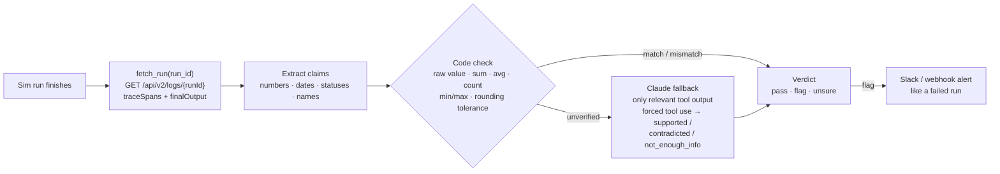

# Crosscheck

**Catching agent runs that finish green but get the answer wrong. Built for [Sim](https://sim.ai).**

An agent run on Sim can finish with a green status while its final answer contradicts what its own
tools returned. The tool says 10, the agent says 12, and nothing flags it. Sim Logs record every tool
input and output per span, but a run only counts as failed when something *errors*. Sim's Guardrails
hallucination check compares against a knowledge base, not against the live tool outputs of that same run.

Crosscheck reads a finished Sim run and checks every claim in the final answer against that run's tool
outputs. Plain code does the checking first. Claude is only called for claims code can't settle, which keeps
the check cheap enough to run on every execution.

## How it works



| Step | Module | What it does |
|---|---|---|
| 1. Pull the trace | [`trace.py`](crosscheck/trace.py) | Fetches the run from the Sim Logs API (or a saved fixture) and walks the recursive `traceSpans`: agent `toolCalls` and standalone tool/integration blocks become `(span_id, tool, input, output)`. |
| 2. Extract claims | [`claims.py`](crosscheck/claims.py) | Numbers (currency, `%`, `k/M/B`, "about"/"roughly" marks it approximate), dates (ISO, `March 3, 2026`, `3/14/2026`), statuses (only after a copula for ambiguous words like *open*/*clear*), quoted or multi-word proper names. IDs such as `ORD-1042` are kept as anchors, not numbers. |
| 3. Code check | [`checker.py`](crosscheck/checker.py) | Flattens tool outputs into values and records. Adds derived values: sum/average/min/max/count of every list, per-status counts, and totals across several tool calls. A claim is matched to a record named in the same sentence first, then by overlap between the words around the claim and the tool's key names. A match is accepted within the claim's display precision (`4.3` vs `4.27`), or within 5% if the claim is approximate. |
| 4. LLM fallback | [`llm.py`](crosscheck/llm.py) | Sends only unverified claims, plus only the tool outputs that share words with them (capped at 6k chars), in one call per run. The verdict comes back via forced tool use (`tool_choice: record_verdicts`, strict schema). Default model is `claude-haiku-5-5`. Models that reject forced tool choice get `auto` + strict schema. |
| 5. Verdict | [`core.py`](crosscheck/core.py) | `flag` if any claim is contradicted, `unsure` if any is left unresolved, else `pass`. Each flag names the claim, expected value, actual value, and source span. |
| 6. Alert | [`alert.py`](crosscheck/alert.py) | A flagged run posts to Slack (`SLACK_WEBHOOK_URL`) and/or any webhook (`CROSSCHECK_WEBHOOK_URL`, for example a Sim webhook-triggered workflow). |

Example flag, from `look-07`:

```json
{"claim": "clear", "kind": "status", "verdict": "mismatch", "expected": "consider", "actual": "clear",
 "span_id": "look-07-tool-0", "evidence": "$.result", "checked_by": "code"}
```

## Results

20 runs across three agents: **numbers** (counts, prices, revenue, incl. a total summed across 3 tool
calls), **lookup** (names, dates, statuses, incl. a Checkr-style background check), and **text** (Tavily
search, then a summary). 10 runs are clean and 10 have a planted mismatch. Reproduce with
`python eval/make_fixtures.py && python eval/run_eval.py --no-llm`.

| Measure | Code only | Code + Claude fallback |
|---|---|---|
| Runs evaluated | 20 | _pending: run with `ANTHROPIC_API_KEY`_ |
| Planted mismatches caught | **9 of 10** (1 left `unsure`) | |
| False alarms on clean runs | **0 of 10** | |
| Claims checked by code | 52 of 53 (98%) | |
| Claims sent to the LLM | 1 (2%) | |
| Added latency per run (s) | 0.003 | |
| Added cost per run (USD) | $0 | |

Full per-run output: [`eval/results_code_only.md`](eval/results_code_only.md).

### Read these numbers honestly

* **The runs are Sim-shaped fixtures, not live Sim executions.** Each file has the exact shape of
  `GET /api/v2/logs/{runId}` (trace spans, `toolCalls`, `finalOutput`), but the answers were written by hand,
  so they are cleaner than real LLM prose. To evaluate on real runs, run
  `python -m crosscheck pull --workspace <id>` and edit `eval/answer_key.csv`.
* **The heuristics were tuned on this same set.** The first code-only pass caught 8/10 with 1 false alarm. The
  four failure cases below were fixed afterwards. The unit tests in `tests/` include cases written after
  tuning (rounding, `about` tolerance, list sums, percent vs fraction, per-status counts), and all of them pass.
  A held-out set of real runs is still the real test.

### Failure cases (and what they taught)

1. **`num-07`: the wrong average hid behind a raw value.** The agent said the "average order value" was $412.
   The true average is $368.50, but one individual order *was* $412, so the first version accepted it. Fix:
   when the claim names an aggregate (average, total, count…), only aggregate values can support it.
2. **`look-06`: false alarm on a clean Checkr run.** The record had `status: complete` *and* `result: clear`.
   The checker compared "clear" with the first status-like field. Fix: compare a status with the field from
   its own family (screening results vs lifecycle states vs shipping states).
3. **`text-05`: "plans to *open* a second plant" read as a status claim.** Fix: ambiguous status words only
   count after a copula ("is open", "came back clear") or before "status". Past-tense events ("shipped on")
   still count on their own.
4. **`text-04`: wrong lead investor ("Summit Capital" vs "Harbor Ventures").** Code can tell the name is
   *absent* from the search results, but not that it is *wrong*, so the run stays `unsure`. This is the case
   the Claude fallback is for, and the only claim in the set it receives.

**Known risk:** derived values the agent computed in a way the rules don't cover (a weighted average, a
difference between two tool values, a sum over a filtered subset) will be `unverified` and go to the LLM.
They should not be flagged by code.

## Run it

```bash
pip install -r requirements.txt
python eval/make_fixtures.py
python eval/run_eval.py --no-llm          # or set ANTHROPIC_API_KEY and drop --no-llm
python -m pytest -q
```

Check one run against a Sim instance:

```bash
export SIM_BASE_URL=http://localhost:3000   # or https://www.sim.ai
export SIM_API_KEY=...
python -m crosscheck check <run_id>
```

### As a service called from Sim

```bash
uvicorn crosscheck.api:app --port 8008
```

`POST /check` with `{"run_id": "..."}`, or `{"log": <log detail JSON>}` to skip the fetch. It returns the
verdict, flags, every finding, and stats (claims, code vs LLM, latency, LLM tokens and cost). With
`SLACK_WEBHOOK_URL` set, flagged runs post to Slack. See [`sim/README.md`](sim/README.md) to wire it into a
workflow as a final block or as a scheduled audit over recent runs.

| Env var | Purpose |
|---|---|
| `SIM_BASE_URL`, `SIM_API_KEY` | Sim Logs API |
| `CROSSCHECK_FIXTURES` | Directory of saved run JSON, checked before the API |
| `ANTHROPIC_API_KEY` | Enables the Claude fallback (`CROSSCHECK_LLM=0` disables it) |
| `CROSSCHECK_MODEL` | Default `claude-haiku-5-5` |
| `SLACK_WEBHOOK_URL`, `CROSSCHECK_WEBHOOK_URL` | Alert destinations for flagged runs |

## Next inside Sim

Make answer consistency a native check that sits next to success rate, run time, and cost in Logs, and that
teams can set as an alert condition. The trace data is already there: this only needs a post-run hook over
`traceSpans` and `finalOutput`.
